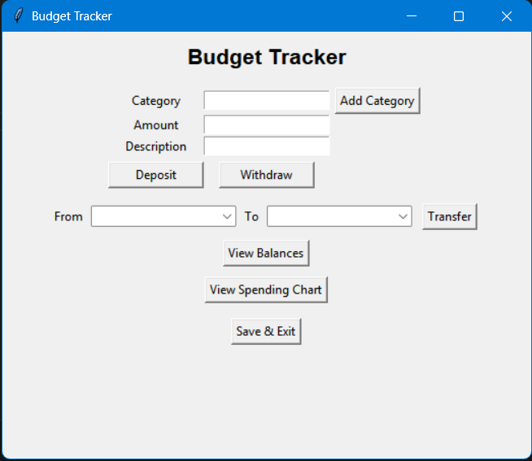
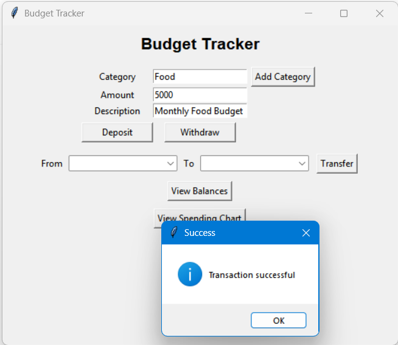
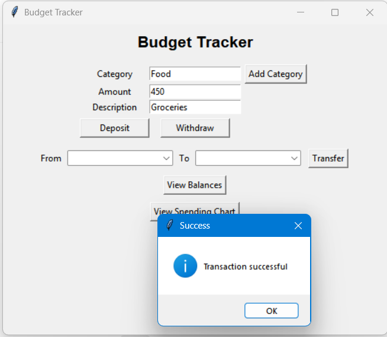
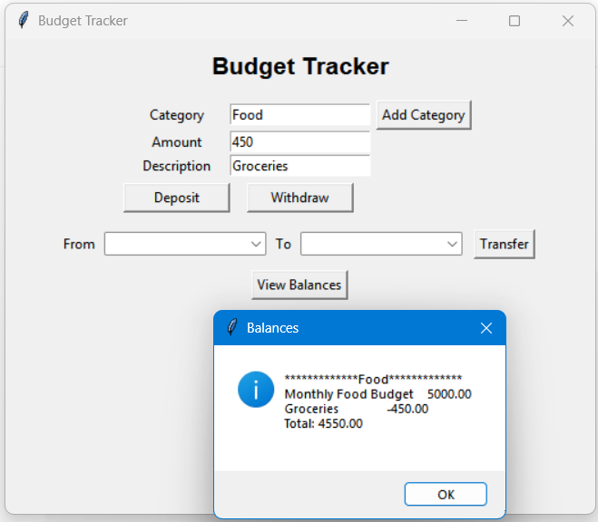

# Budget Tracker — Python GUI

A desktop personal-budget application built with Python, Tkinter, object-oriented programming, and JSON persistence.

## Features

- Create budget categories
- Deposit and withdraw funds with positive-amount validation
- Transfer money between different categories
- View category balances and a percentage-based spending chart
- Automatically save after successful changes and when closing the window

## Tech Stack

- Python
- Tkinter GUI
- Object-oriented programming (OOP)
- JSON file storage

## Run locally

1. Install Python 3.10 or later.
2. Clone or download this repository.
3. From the project folder, run:

```bash
python main.py
```

The app stores its data in `budget_data.json` in the working directory. Keep this file private if it contains personal financial information; it is intentionally not committed to the repository.

## Screenshots

### Main application interface


### Deposit transaction


### Expense withdrawal


### Category balances


## Validation

The app rejects non-positive and non-finite transaction amounts, prevents transfers to the same category, handles empty/no-spending charts, and saves changes on successful transactions and window close.

## Attribution

This repository contains a Python GUI implementation. If any design or exercise logic was adapted from another tutorial or project, retain the original attribution here and distinguish those additions from the source material.
